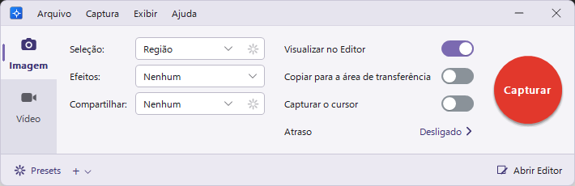

# Snapnab

**Captura de tela, gravação de vídeo e editor de imagens para Windows.**



O Snapnab fica na área de notificação: aperte **Print Screen**, escolha o que capturar e a imagem abre no
**Snapnab Editor**, pronta para anotar, destacar e compartilhar. Também grava a tela em MP4, com microfone e áudio do sistema.

## Recursos

**Captura**
- Região, janela, tela inteira, monitor, região de tamanho fixo, mão livre, várias áreas, objeto sob o cursor,
  rolagem panorâmica (você rola, ele junta), rolagem automática de janela, janela estendida, menus, área de transferência e arquivo
- **Capturar texto**: reconhece o texto da região (OCR) e copia para a área de transferência
- Lupa e coordenadas na mira, atraso com contagem regressiva, captura do cursor
- Presets com atalhos globais e destinos: Editor, área de transferência, arquivo com nome automático, programa externo, texto
- **One Click**: painel discreto preso à borda da tela, que abre com o mouse em cima (*Exibir › Mostrar o One Click*)
- 12 efeitos aplicados na hora: borda, filtros, sombra, informações da captura, substituição de cor, redimensionar,
  bordas especiais, cortar bordas, ajuste de cor, girar, marca d'água e resolução

**Gravação de vídeo**
- MP4 (H.264 + AAC), microfone e áudio do sistema com mudo separado, pausa sem buraco no vídeo
- Webcam em bolha redonda dentro do vídeo, que pode ser arrastada durante a gravação
- Painel de controle e moldura que não aparecem na gravação, redução para 1080p, codificação por hardware

**Editor**
- Seta, linha, formas, caneta, marcador, texto, balões, passos numerados, carimbos, desfoque, destaque, lupa,
  preencher, borracha, conta-gotas, cortar e recortar faixa
- Seleção com Smart Move, varinha mágica e preenchimento inteligente; desfazer/refazer
- Efeitos de imagem, reconhecimento de texto (OCR), salvar em PNG, JPG, BMP, GIF, TIFF, PDF e `.snap`, imprimir e e-mail
- Vídeo: cortar trechos, salvar quadro, criar GIF animado e exportar MP4
- Biblioteca com todas as capturas

**Idiomas**
- Português, inglês, chinês (simplificado), hindi, espanhol, árabe, francês, bengali, russo, indonésio, urdu e alemão;
  segue o idioma do Windows (inglês se não houver tradução) e muda em *Arquivo › Opções… › Idioma*

A janela de captura acompanha a cor de destaque escolhida em *Configurações > Personalização > Cores*.

## Instalação

Requer **Windows 10 versão 2004 ou mais novo, ou Windows 11 (64 bits)**. Não precisa de nenhum runtime extra.

- **Portátil:** baixe `Snapnab-<versão>-win-x64.zip` na página de *Releases*, extraia em qualquer pasta e abra `Snapnab.exe`.
- **Instalador:** abra `Snapnab-<versão>-setup.exe` e siga o assistente. Ele instala só para você (sem pedir
  administrador) ou para todos os usuários, cria os atalhos no menu Iniciar, pode iniciar o Snapnab com o Windows e
  desinstala por *Configurações › Aplicativos*. Suas capturas e configurações são mantidas ao desinstalar.

## Uso

| Atalho | Ação |
|---|---|
| `Print Screen` | capturar imagem |
| `Shift+Print Screen` | gravar vídeo (de novo para parar) |
| `Shift+F9` | pausar / retomar a gravação |
| `Shift+F10` | parar a gravação |
| `Esc` | cancelar a seleção |

Os atalhos podem ser trocados em *Opções*. Linha de comando:

```text
Snapnab.exe        /capture | /video | /preset "nome" | /clipboard | /hide | /exit | /help
SnapnabEditor.exe  /Open "arquivo" | /NewFromClipboard | /help
```

### Seus dados

| O quê | Onde |
|---|---|
| Capturas e vídeos | `%LOCALAPPDATA%\Snapnab\Library` |
| Presets | `%LOCALAPPDATA%\Snapnab\Presets1.xml` |
| Logs | `%LOCALAPPDATA%\Snapnab\Logs` |
| Configurações | `HKEY_CURRENT_USER\Software\Snapnab` |

Nada é enviado para a internet.

## Compilar a partir do código

Com o Visual Studio 2022+ (carga *Desenvolvimento para desktop com C++*):

```bat
build.bat
```

O programa sai em `dist\Snapnab\` e o pacote em `dist\Snapnab-<versão>-win-x64.zip`. Detalhes, testes e instalador em
[docs/BUILDING.md](docs/BUILDING.md).

## Estrutura do repositório

```text
src/                    código-fonte (C++20, Win32)
  common/               biblioteca compartilhada pelos dois programas
  capture/              Snapnab.exe — captura e gravação
  editor/               SnapnabEditor.exe — editor
  snapex/               SnapEx64.dll — captura de janela estendida
  resources/            ícones e manifesto
tests/                  testes de integração
lang/                   traduções da interface (gettext: <idioma>.po e o modelo snapnab.pot)
packaging/              arquivos do pacote e script do instalador
scripts/                utilitários de desenvolvimento (i18n.py extrai e confere as traduções)
docs/                   arquitetura, build e imagens
```

A arquitetura e o mapeamento para os documentos de referência estão em [docs/ARCHITECTURE.md](docs/ARCHITECTURE.md).
O histórico de versões está em [CHANGELOG.md](CHANGELOG.md).

## Licença

Copyright © 2026 Antonio Rezende.

O Snapnab é software livre: você pode usar, estudar, modificar e redistribuir sob os termos da
[GNU General Public License versão 3](LICENSE). Versões modificadas que forem distribuídas também precisam ter o
código aberto sob a mesma licença. O programa é fornecido sem garantia de qualquer tipo.
